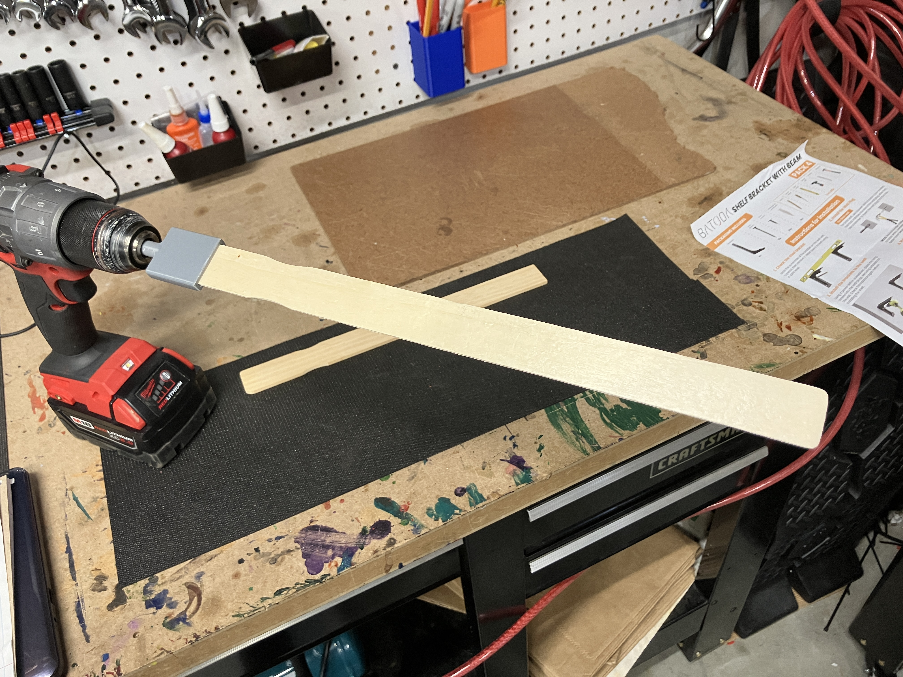
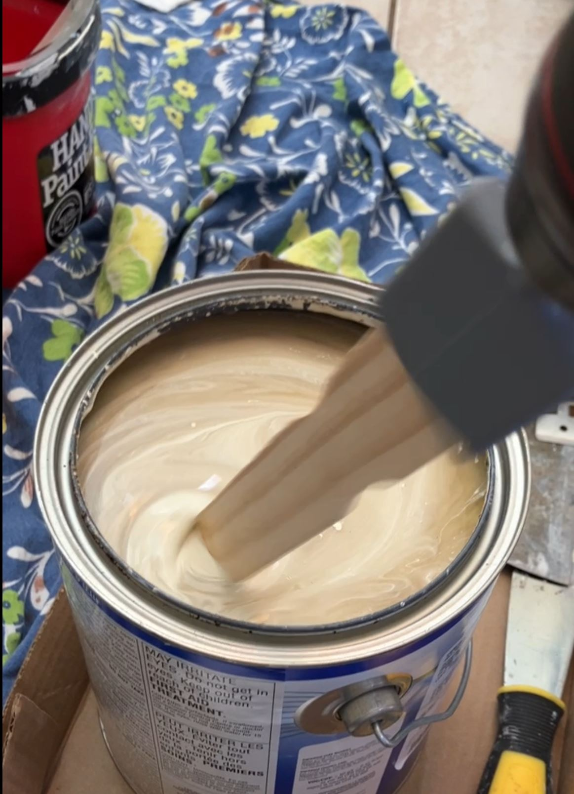

# Paint Stick Drill Adapter

  
  &nbsp;
  

This adapts a drill to a common wooden paint stick so that you can mix your can of paint faster with the included disposable sticks and avoid the mixing mess.

The trick to the adapter is that there is a taper in the opening and it's made a little extra wide, so it accommodates most of the paint sticks that are commonly given away when purchasing paint (at least in the US).

The 3D-printed CAD has the taper built in. The .f3d files are Fusion 360 CAD files; the .step file is a neutral export for use in other CAD tools.

Video of it in action: [images/In_Action.MOV](images/In_Action.MOV)

## Manufacturing notes

This could easily be mass produced using plastic injection molding. When printed with PLA filament on a Bambu printer, the bit needed 100% infill where the stem meets the adapter so it would not break from the torque. Injection-molded plastic would probably be stronger. Also, a 1/4" metal hex shank would make it work with even more tools, since that is becoming the standard these days.

Advertising could be put on the flat outside face of the adapter. I have some mockups that do that. Very slick.

## Patent status

Provisional Patent Application Number: 63/678,254 (200554). Filed 8/1/2024, expired 8/1/2025.

No non-provisional (full) patent application was submitted. Posting here should make this "prior art". See [Historical_Patent_Documents](Historical_Patent_Documents/).

## License

Copyright 2024-2026 V-Tank, LLC

- Hardware design files (`3d-Files/`) are licensed under CERN-OHL-P-2.0 (see [LICENSE](LICENSE)).
- Documentation, pictures and video are licensed under CC-BY-4.0 (see [LICENSE-DOCS](LICENSE-DOCS)).
- See [NOTICE](NOTICE) for attribution requirements.
